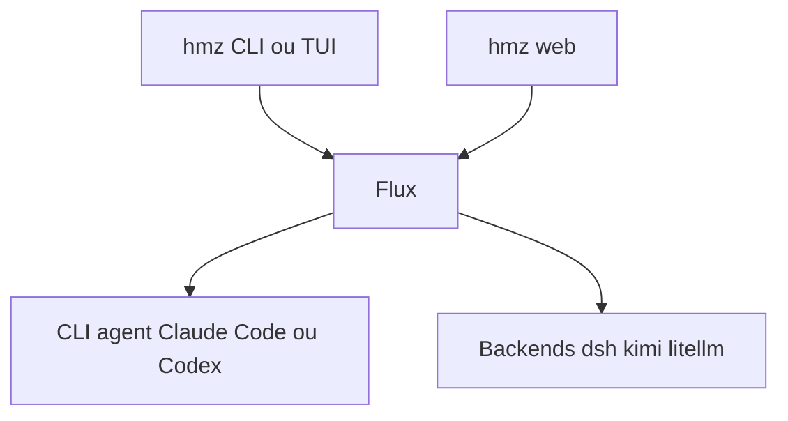

# humania-org/humanize

> Agent workflow system (`hmz`) that drives coding agent CLIs such as Claude Code or Codex.

## The problem
Chaining several coding agents on a repository, while tracking their epics, is done by hand.

## What it actually does
A CLI and a terminal interface, plus `hmz web` to browse all the epics in a browser, and a desktop application (macOS, Windows via WSL 2). `hmz exec` launches a workflow from the shell with a chosen agent (for example claude/claude-opus-5:high). Optional backends: DeepSeek Harness, Kimi Code, litellm.

## How it is wired
Simplified diagram based on the sheet, no diagram provided.



## Trying it
```bash
uv tool install hmz
uv tool install 'hmz[all]'
hmz
hmz web
hmz exec -f chat -a assistant=claude/claude-opus-5:high "What does this repository do?"
```

## Cost and gotchas
Python 3.12 or later, uv, and an agent CLI that is already logged in. Each agent consumes your subscription or your tokens. The slogan talks about "token maxxing": plan for the bill.

## What it is not
Not an agent in itself. The agents run with approvals bypassed: do not run it on an important repository.

## Alternatives
No alternative named in the README.

## For you
Worth watching: interesting if you orchestrate coding agents, but recent (July 2026), and running without approval requires a disposable repository.
