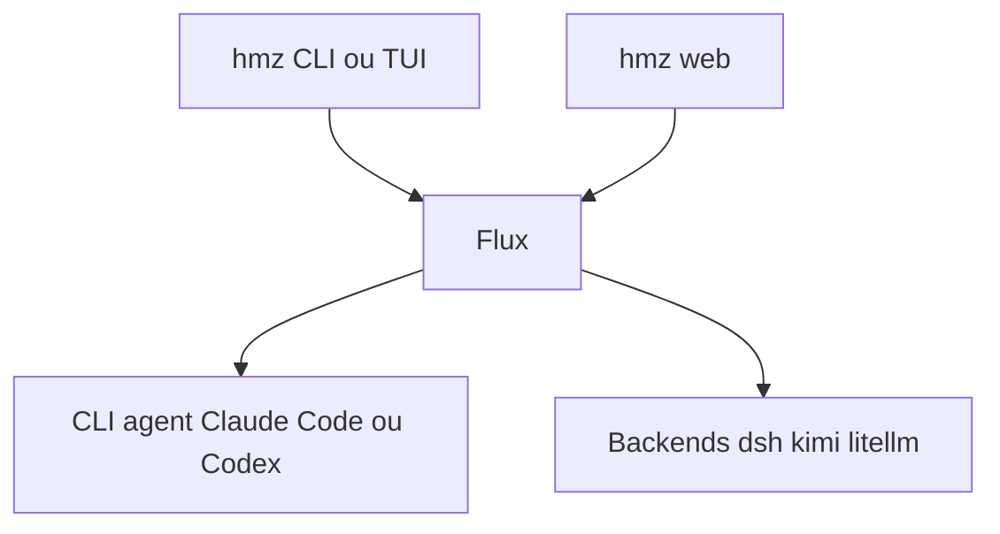

# humania-org/humanize

> Système de flux d'agents (`hmz`) qui pilote des CLI d'agents de code comme Claude Code ou Codex.

## Le problème
Enchaîner plusieurs agents de code sur un dépôt, avec suivi de leurs épopées, se fait à la main.

## Ce que ça fait vraiment
Une CLI et une interface terminal, plus `hmz web` pour parcourir toutes les épopées dans un navigateur, et une application bureau (macOS, Windows via WSL 2). `hmz exec` lance un flux depuis le shell avec un agent choisi (par exemple claude/claude-opus-5:high). Des backends optionnels : DeepSeek Harness, Kimi Code, litellm.

## Comment c'est branché
Schéma simplifié d'après la fiche, sans diagramme fourni.



## Essayer
```bash
uv tool install hmz
uv tool install 'hmz[all]'
hmz
hmz web
hmz exec -f chat -a assistant=claude/claude-opus-5:high "What does this repository do?"
```

## Coût et pièges
Python 3.12 ou plus, uv, et une CLI d'agent déjà connectée. Chaque agent consomme ton abonnement ou tes jetons. Le slogan parle de « token maxxing » : prévois la facture.

## Ce que ce n'est pas
Pas un agent en soi. Les agents tournent avec les approbations contournées : ne le lance pas sur un dépôt important.

## Alternatives
Aucune alternative nommée dans le README.

## Pour toi
À surveiller : intéressant si tu orchestres des agents de code, mais récent (juillet 2026), et l'exécution sans approbation impose un dépôt jetable.

