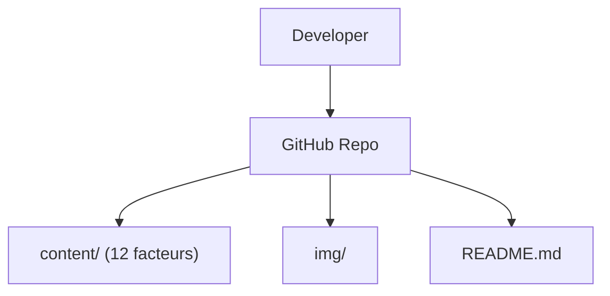

# humanlayer/12-factor-agents

> Twelve principles for building reliable LLM applications in production, for engineers to read.

## The problem
Agent frameworks plateau around 70-80% quality and force you to rewrite everything to reach customer-grade level.

## What it actually does
A Markdown guide: twelve factors (own your prompts, your context, your control flow; tools as structured outputs; agent as a stateless reducer; etc.). Central idea: integrate small agent concepts into an existing product rather than adopting a whole framework. No application code.

## How it is wired

The provided diagram assumes a web build chain, unconfirmed: this is a content repository.

## Trying it
No command: read the files in `content/` (factor-01 to factor-12).

## Cost and gotchas
Free. License present but not identified by GitHub: check before reusing the text.

## What it is not
Not a framework or a library. Examples mostly in TypeScript. The README says it does not cover MCP.

## Alternatives
- Building Effective Agents (Anthropic): cited reference.
- BAML: cited for structured outputs.

## For you
Adopt as reading: a clear framework for designing reliable agents, directly useful in AI engineering.
