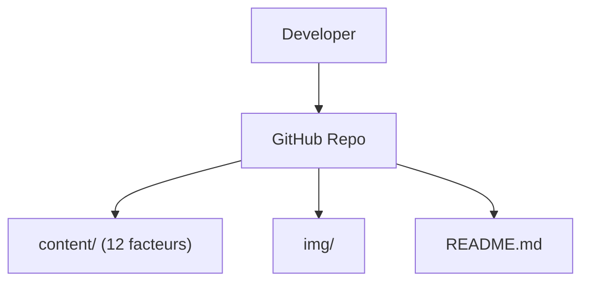

# humanlayer/12-factor-agents

> Douze principes pour construire des applications LLM fiables en production, à lire par les ingénieurs.

## Le problème
Les frameworks d'agents plafonnent vers 70-80 % de qualité et obligent à tout réécrire pour atteindre le niveau client.

## Ce que ça fait vraiment
Un guide Markdown : douze facteurs (posséder ses prompts, son contexte, son flux de contrôle ; outils comme sorties structurées ; agent comme réducteur sans état ; etc.). Idée centrale : intégrer de petits concepts d'agents dans un produit existant plutôt que d'adopter un framework entier. Aucun code d'application.

## Comment c'est branché

Le diagramme fourni suppose une chaîne de build web, non confirmée : c'est un dépôt de contenu.

## Essayer
Aucune commande : lire les fichiers de `content/` (factor-01 à factor-12).

## Coût et pièges
Gratuit. Licence présente mais non identifiée par GitHub : vérifier avant réutilisation du texte.

## Ce que ce n'est pas
Pas un framework ni une bibliothèque. Exemples surtout en TypeScript. Le README dit ne pas traiter MCP.

## Alternatives
- Building Effective Agents (Anthropic) : référence citée.
- BAML : cité pour les sorties structurées.

## Pour toi
À adopter comme lecture : cadre clair pour concevoir des agents fiables, directement utile en AI engineering.

