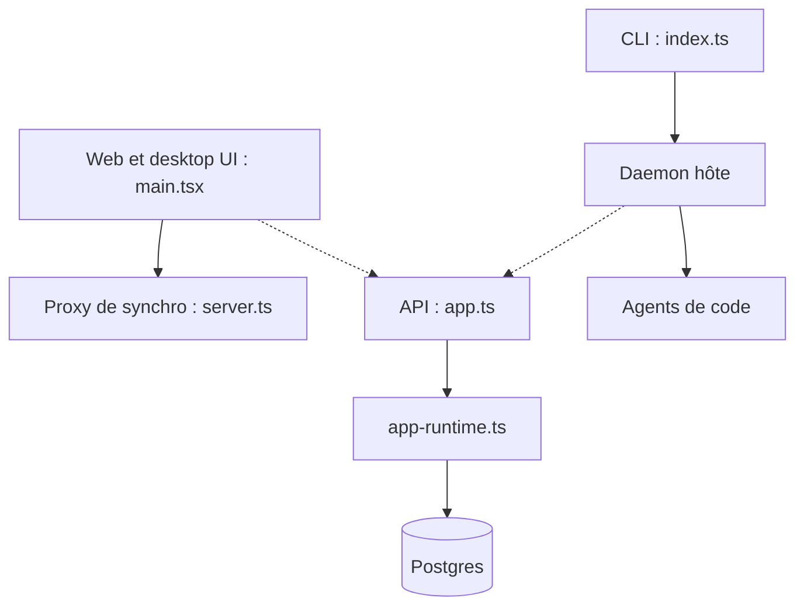

# humanlayer/humanlayer

> Team platform for launching coding agents on your own machines and driving them from a single interface.

## The problem
Several coding agents run on several machines, with no shared view of tasks, sessions, plans and reviews.

## What it actually does
A Turborepo monorepo (Bun): web and desktop application, a daemon that runs agent sessions (Claude Code, Codex, OpenCode, Pi) on each host, a `humanlayer` CLI that delivers the daemon, an oRPC + Hono API, Postgres sync via Electric, GitHub and Jira integrations, billing. Plugins mirror sessions into HumanLayer.

## How it is wired


## Trying it
```bash
bun install
cp .env.example .env
bun --bun run typecheck
bun run test
bun --bun run devstack help
```

## Cost and gotchas
Bun and Docker required, Rust for the native app. The provided Docker Compose uses default passwords that must be changed. The self-hosting guide is "in progress".

## What it is not
It is not an agent: it orchestrates agents from other vendors. Self-hosting is not documented yet; HumanLayer Cloud runs this same code. Builds from source send nothing (Sentry and PostHog stay off without variables).

## Alternatives
No alternative cited in the README.

## For you
Worth watching: useful if your team runs several coding agents, but self-hosting is not ready.
