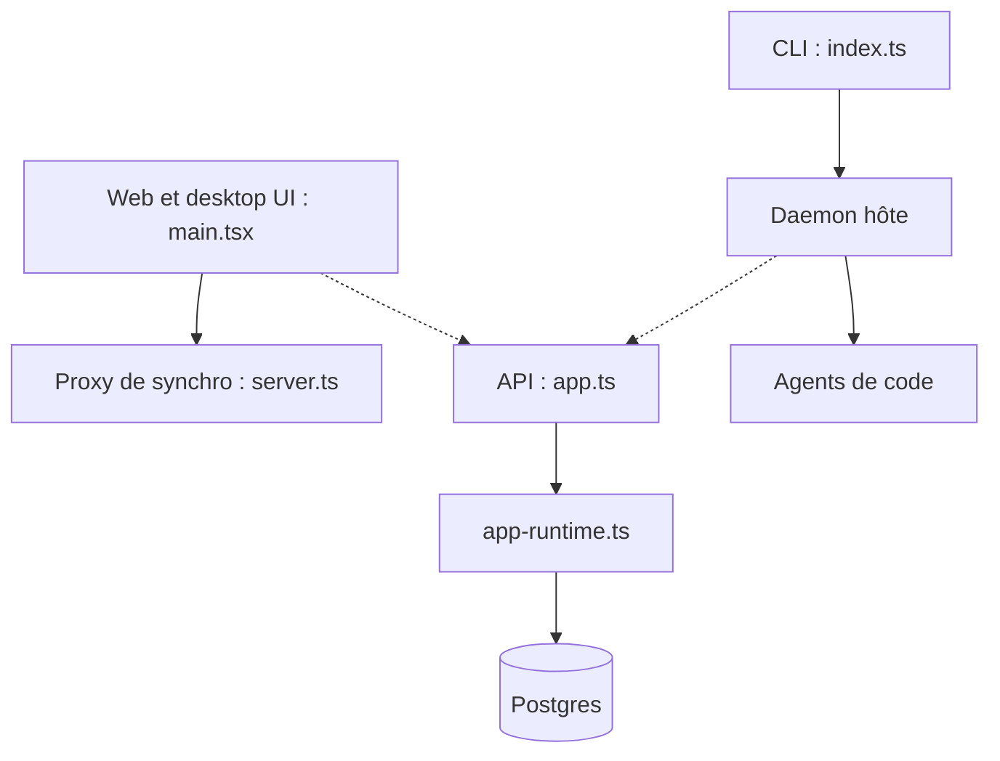

# humanlayer/humanlayer

> Plateforme d'équipe pour lancer des agents de code sur ses machines et les piloter depuis une seule interface.

## Le problème
Plusieurs agents de code tournent sur plusieurs machines, sans vue commune des tâches, sessions, plans et revues.

## Ce que ça fait vraiment
Un monorepo Turborepo (Bun) : application web et desktop, daemon qui exécute les sessions d'agents (Claude Code, Codex, OpenCode, Pi) sur chaque hôte, CLI `humanlayer` qui livre le daemon, API oRPC + Hono, synchro Postgres via Electric, intégrations GitHub et Jira, facturation. Les plugins reflètent les sessions dans HumanLayer.

## Comment c'est branché


## Essayer
```bash
bun install
cp .env.example .env
bun --bun run typecheck
bun run test
bun --bun run devstack help
```

## Coût et pièges
Bun et Docker requis, Rust pour l'app native. Le Docker Compose fourni utilise des mots de passe par défaut à changer. Le guide d'auto-hébergement est « en cours ».

## Ce que ce n'est pas
Ce n'est pas un agent : il orchestre ceux d'autres éditeurs. L'auto-hébergement n'est pas encore documenté ; HumanLayer Cloud fait tourner ce même code. Les builds depuis les sources n'envoient rien (Sentry, PostHog restent éteints sans variables).

## Alternatives
Aucune alternative citée dans le README.

## Pour toi
À surveiller : utile si ton équipe lance plusieurs agents de code, mais l'auto-hébergement n'est pas prêt.

