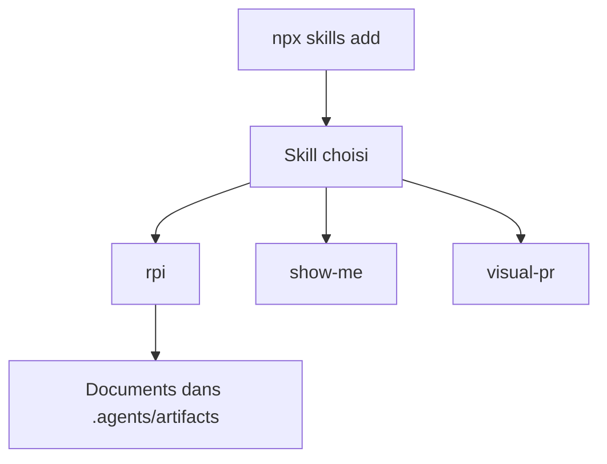

# humanlayer/skills

> Collection of Claude Code skills from HumanLayer: research, PRD, visual review, agent loops.

## The problem
Coding agents lack reusable procedures to plan, implement and review a change.

## What it actually does
Seven skills installable one by one: `rpi` (research, design discussion, PRD then TDD, implementation with phases in separate sessions), `show-me` (diagrams and HTML artifacts), `visual-pr`, `improve-claude-md`, `narrow-react-prop-types`, `build-iterated-agentic-loop`, `design-control-loop`.

## How it is wired
Simplified diagram based on the sheet, no diagram provided.



## Trying it
```bash
npx skills add humanlayer/skills --skill rpi
```
```text
/rpi research how the collections connect to the database
/rpi make a PRD
```

## Cost and gotchas
Free, but uses your coding agent and its tokens. In Codex, the sandbox may make `.agents` read-only.

## What it is not
Not a standalone tool: these are instructions for an already installed agent. The README shows no measured results.

## Alternatives
No alternative named in the README.

## For you
Worth watching: if you work with Claude Code, `rpi` and `design-control-loop` deserve a try on a small project.
