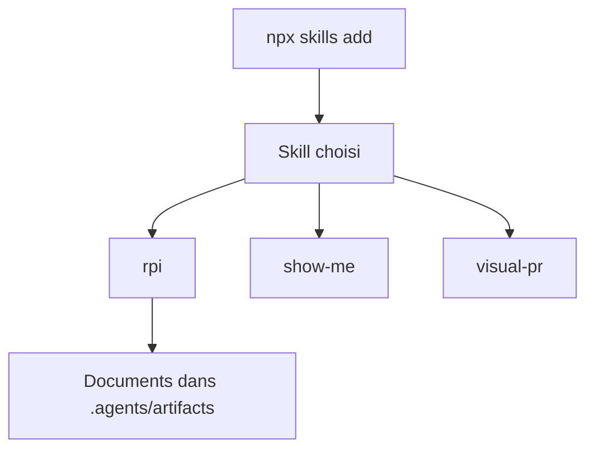

# humanlayer/skills

> Collection de skills pour Claude Code de HumanLayer : recherche, PRD, revue visuelle, boucles d'agents.

## Le problème
Les agents de code manquent de procédures réutilisables pour planifier, implémenter et relire une modification.

## Ce que ça fait vraiment
Sept skills installables un par un : `rpi` (recherche, discussion de design, PRD puis TDD, implémentation avec phases en sessions séparées), `show-me` (diagrammes et artefacts HTML), `visual-pr`, `improve-claude-md`, `narrow-react-prop-types`, `build-iterated-agentic-loop`, `design-control-loop`.

## Comment c'est branché
Schéma simplifié d'après la fiche, sans diagramme fourni.



## Essayer
```bash
npx skills add humanlayer/skills --skill rpi
```
```text
/rpi research how the collections connect to the database
/rpi make a PRD
```

## Coût et pièges
Gratuit, mais utilise ton agent de code et ses jetons. Dans Codex, le bac à sable peut rendre `.agents` en lecture seule.

## Ce que ce n'est pas
Pas un outil autonome : ce sont des consignes pour un agent déjà installé. Le README ne montre pas de résultats mesurés.

## Alternatives
Aucune alternative nommée dans le README.

## Pour toi
À surveiller : si tu travailles avec Claude Code, `rpi` et `design-control-loop` méritent un essai sur un petit chantier.

