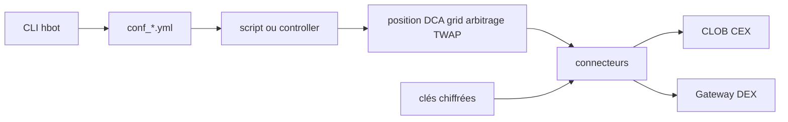

# hummingbot/hummingbot

> Open-source framework for writing and running trading bots on centralized or decentralized exchanges.

## The problem
Plugging a strategy into ten marketplaces means rewriting ten REST and WebSocket integrations.
And testing a strategy without risking real money requires a simulation that holds up.

## What it actually does
Normalizes exchange APIs behind connectors classified as CLOB CEX, CLOB DEX and AMM DEX.
Offers four levels of authoring: single-file scripts, V2 controllers tunable on the fly, executors, V1 strategies.
The `hbot` CLI drives a bot non-interactively: config creation, start, status, stop, PnL, logs.
The `binance_paper_trade` paper mode replays real market data without an API key.

## How it is wired


## Trying it
```bash
git clone https://github.com/hummingbot/hummingbot.git
cd hummingbot
make install
conda activate hummingbot
hbot create simple_pmm --name conf_paper_bot.yml --set exchange=binance_paper_trade --set trading_pair=BTC-USDT
hbot start conf_paper_bot.yml
hbot status
hbot stop
```

## Cost and gotchas
Anaconda or Miniconda is required for installation from source. On first launch, `hbot` asks for
a keystore password that encrypts your exchange keys; in scripts, you need `HBOT_PASSWORD` or `--password-stdin`.

## What it is not
Not a turnkey profitable strategy: these are building blocks, market risk remains entirely yours.
Not silent: the README points to a "Reporting" page about anonymous data collection.
Not multi-bot per installation: the README states "one bot per install".

## Alternatives
`Condor` — the same project's AI harness, for LLM-driven agentic strategies.
`Hummingbot API` / `Gateway` — companion repos if you only want the hub or the DEX client.

## For you
Outside your data/AI axis, except out of curiosity: this is trading engineering, not modeling.
