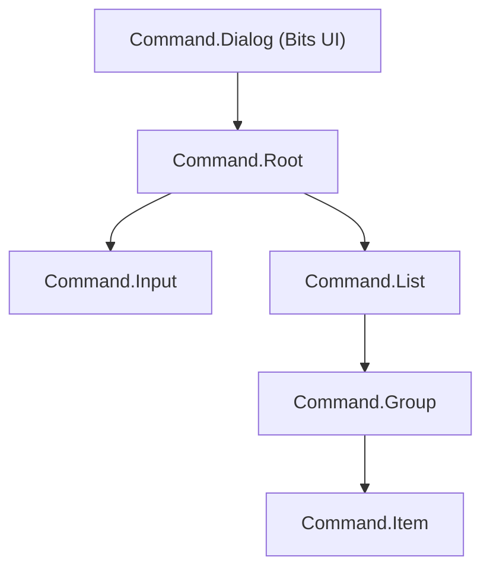

# huntabyte/cmdk-sv

> Accessible Svelte command menu component, a port of cmdk, for front-end developers.

## The problem
Building a ⌘K-style menu by hand, with filtering, sorting and accessibility, takes time.

## What it actually does
Command components (Root, Dialog, Input, List, Item, Group, Empty, Loading) that filter and rank entries, with custom filter, controlled states, and no imposed styling. The dialog relies on Bits UI.

## How it is wired
Simplified diagram based on the sheet, no diagram provided.


## Trying it
```bash
npm install cmdk-sv
```

## Cost and gotchas
Free. Archived repository, last push in March 2025: no more fixes expected. The ⌘K shortcut has to be wired up yourself.

## What it is not
Not a complete UI framework: it provides no styling.

## Alternatives
- cmdk (the React version it is a port of).

## For you
Ignore: an archived Svelte UI component, outside your data / AI field.
