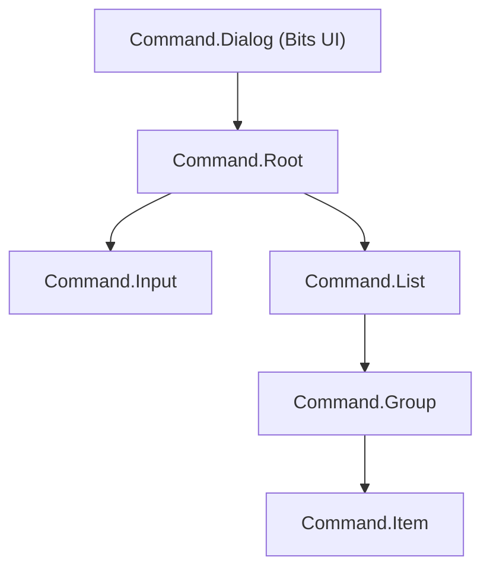

# huntabyte/cmdk-sv

> Composant Svelte de menu de commandes accessible, portage de cmdk, pour développeurs front.

## Le problème
Construire à la main un menu de type ⌘K avec filtre, tri et accessibilité prend du temps.

## Ce que ça fait vraiment
Composants Command (Root, Dialog, Input, List, Item, Group, Empty, Loading) qui filtrent et classent les entrées, avec filtre personnalisable, états contrôlés, sans style imposé. Le dialogue repose sur Bits UI.

## Comment c'est branché
Schéma simplifié d'après la fiche, sans diagramme fourni.


## Essayer
```bash
npm install cmdk-sv
```

## Coût et pièges
Gratuit. Dépôt archivé, dernier push en mars 2025 : plus de correctifs attendus. Le raccourci ⌘K reste à brancher soi-même.

## Ce que ce n'est pas
Pas un framework d'interface complet : il ne fournit aucun style.

## Alternatives
- cmdk (version React dont il est le portage).

## Pour toi
À ignorer : composant d'interface Svelte archivé, hors de ton métier data / IA.

