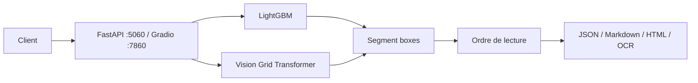

# huridocs/pdf-document-layout-analysis

> PDF layout analysis microservice: segmentation, OCR, reading order, Markdown or HTML export.

## The problem
Cleanly extracting titles, tables, formulas and figures from a PDF, in the right order, is the fragile link in any document pipeline.

## What it actually does
A FastAPI service and a Gradio interface. Two models: Vision Grid Transformer (accurate, GPU recommended) or LightGBM (fast, CPU). It segments into 11 DocLayNet categories, applies Tesseract OCR (over 150 languages), extracts tables as HTML and formulas as LaTeX, extracts the table of contents, and converts to Markdown or HTML, with translation via Ollama. Clean layered architecture (domain, use_cases, adapters, ports).

## How it is wired


## Trying it
```bash
make start
curl -X POST -F 'file=@/path/to/your/document.pdf' http://localhost:5060
curl -X POST -F 'file=@/path/to/your/document.pdf' -F "fast=true" http://localhost:5060
make stop
```

## Cost and gotchas
Free; 2 GB of RAM minimum, 5 GB of optional GPU memory, 10 GB of disk. VGT runs at about 13.5 s per page on CPU versus 1.75 s on GPU. Translation requires an Ollama model and an `output_file`.

## What it is not
Not a standalone OCR nor an LLM: it is a structure analyzer. OCR languages beyond the common ones must be installed in the container.

## Alternatives
No alternative named in the README.

## For you
Adopt: a concrete building block for preparing PDFs before a RAG, with a documented API and an explicit choice between accuracy and speed.
