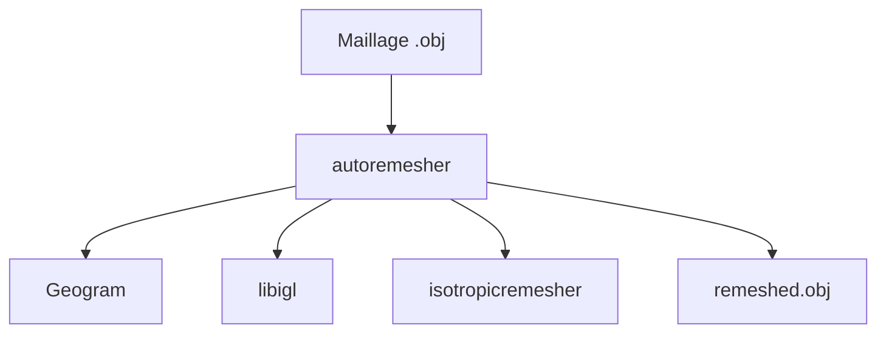

# huxingyi/autoremesher

> Cross-platform automatic remeshing tool: turns dense meshes into clean quad topology.

## The problem
A very dense 3D mesh is heavy and poorly suited to animation or editing; redoing it as clean quads by hand takes hours.

## What it actually does
- Converts a high-density mesh into quads.
- Qt graphical interface and headless command-line mode.
- Settings: target quad count, sharp edges, adaptiveness, anisotropy.
- Builds on Geogram, libigl and isotropicremesher.

## How it is wired
Simplified diagram based on the sheet, no diagram provided.


## Trying it
```bash
qmake
make -j$(nproc)
./autoremesher --input armadillo.obj --output remeshed.obj --target-quads 50000
```

## Cost and gotchas
Free. Building requires a C++14 compiler, Qt 5.15.2 and TBB. Binaries exist for Windows, macOS and Linux (AppImage).

## What it is not
Not a full modeling application. On macOS, Apple blocks the first launch of the binary.

## Alternatives
No alternative named in the README.

## For you
Ignore: useful in 3D, unrelated to your day-to-day data / AI work.
