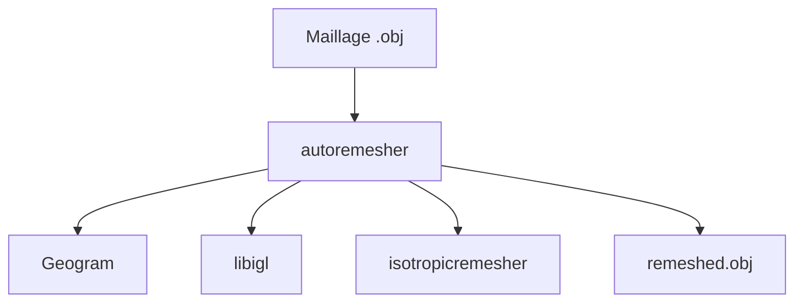

# huxingyi/autoremesher

> Outil multiplateforme de remaillage automatique : transforme des maillages denses en topologie de quadrilatères propre.

## Le problème
Un maillage 3D très dense est lourd et mal adapté à l'animation ou à la retouche ; le refaire en quads propres à la main prend des heures.

## Ce que ça fait vraiment
- Convertit un maillage haute densité en quads.
- Interface graphique Qt et mode ligne de commande sans interface.
- Réglages : nombre de quads cible, arêtes vives, adaptativité, anisotropie.
- S'appuie sur Geogram, libigl et isotropicremesher.

## Comment c'est branché
Schéma simplifié d'après la fiche, sans diagramme fourni.


## Essayer
```bash
qmake
make -j$(nproc)
./autoremesher --input armadillo.obj --output remeshed.obj --target-quads 50000
```

## Coût et pièges
Gratuit. Compilation avec compilateur C++14, Qt 5.15.2 et TBB. Des binaires existent pour Windows, macOS et Linux (AppImage).

## Ce que ce n'est pas
Pas un logiciel de modélisation complet. Sur macOS, Apple bloque la première ouverture du binaire.

## Alternatives
Aucune alternative nommée dans le README.

## Pour toi
À ignorer : utile en 3D, sans lien avec ton quotidien data / IA.

