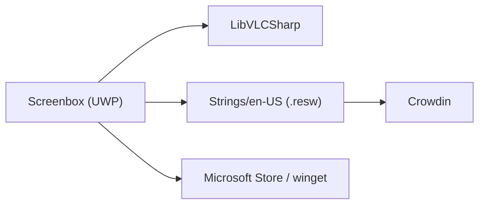

# huynhsontung/Screenbox

> Modern media player for Windows 10/11 and Xbox, built on LibVLCSharp and UWP.

## The problem
Playing videos on Windows with a fast, simple, gesture-friendly interface.

## What it actually does
UWP application with Fluent design, gestures to seek and adjust volume, resizing shortcuts, picture-in-picture mode, video frame capture, Chromecast and playback of media over the network. Available in the Microsoft Store and via `winget`. Translation on Crowdin.

## How it is wired


## Trying it
```bash
winget install screenbox -s winget
git clone https://github.com/huynhsontung/Screenbox.git
# Ouvrir Screenbox.slnx dans Visual Studio 2026, plateforme x64, F5
```

## Cost and gotchas
Free. Building requires Visual Studio 2026 with the UWP workload. Windows 10 version 1903 minimum.

## What it is not
Not a cross-platform tool: Windows and Xbox only. Not a video processing tool.

## Alternatives
None cited in the README.

## For you
Ignore: a simple Windows video player, unrelated to data/AI/MLOps work.
