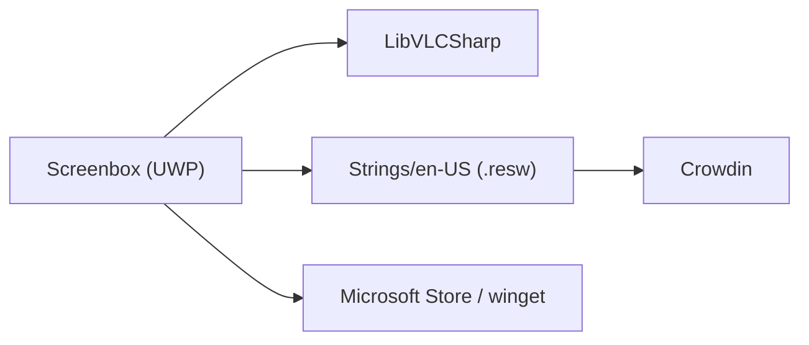

# huynhsontung/Screenbox

> Lecteur multimédia moderne pour Windows 10/11 et Xbox, fondé sur LibVLCSharp et UWP.

## Le problème
Lire des vidéos sur Windows avec une interface rapide, simple et adaptée aux gestes.

## Ce que ça fait vraiment
Application UWP avec design Fluent, gestes pour avancer et régler le volume, raccourcis de redimensionnement, mode image dans l'image, capture d'image de la vidéo, Chromecast et lecture de médias via le réseau. Disponible dans le Microsoft Store et via `winget`. Traduction sur Crowdin.

## Comment c'est branché


## Essayer
```bash
winget install screenbox -s winget
git clone https://github.com/huynhsontung/Screenbox.git
# Ouvrir Screenbox.slnx dans Visual Studio 2026, plateforme x64, F5
```

## Coût et pièges
Gratuit. Compiler demande Visual Studio 2026 avec la charge UWP. Windows 10 version 1903 minimum.

## Ce que ce n'est pas
Pas un outil multiplateforme : Windows et Xbox uniquement. Pas un outil de traitement vidéo.

## Alternatives
Aucune citée dans le README.

## Pour toi
Ignorer : simple lecteur vidéo Windows, sans rapport avec un travail data/IA/MLOps.

