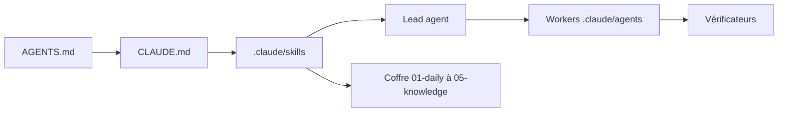

# huytieu/COG-second-brain

> Second brain made of Markdown files driven by AI agent skills, for PMs and leads.

## The problem
Personal and professional notes pile up without synthesis, and each AI agent has its own way of reading them.

## What it actually does
A Markdown vault versioned with Git, where skills (`SKILL.md`) guide the agent: thought dumping, daily briefs, weekly analyses, consolidation, PRD writing, release notes. "Worker" agents collect and publish, and read-only checkers verify. Compatible with Claude Code, Cursor, Gemini CLI, Codex, Kiro.

## How it is wired


## Trying it
```bash
git clone https://github.com/huytieu/COG-second-brain.git
cd COG-second-brain
npx skills add huytieu/COG-second-brain
```
Then run "Run onboarding" in your agent.

## Cost and gotchas
Free, MIT, but your AI agent usage is billed. The integrations (GitHub, Linear, Slack) require accounts and access. Over 40 skills: introduce them gradually.

## What it is not
Not an application: there is no server or database, only instruction files executed by the agent. The "real results" figures in the README cannot be verified.

## Alternatives
gstack and gbrain by Garry Tan, which the project draws inspiration from.

## For you
Worth watching: a good catalog of skills to pick from to structure your own agents, but the whole is heavy to adopt as is.
