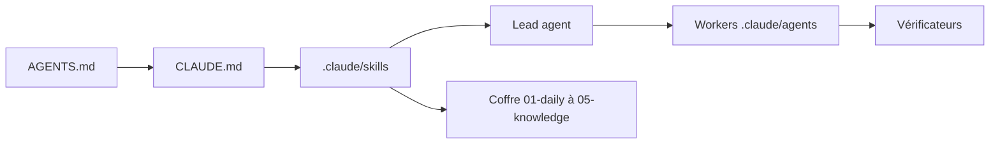

# huytieu/COG-second-brain

> Second cerveau en fichiers Markdown piloté par des skills d'agents IA, pour PM et leads.

## Le problème
Les notes personnelles et professionnelles s'accumulent sans synthèse, et chaque agent IA a sa propre manière de les lire.

## Ce que ça fait vraiment
Un coffre Markdown versionné avec Git, où des skills (`SKILL.md`) guident l'agent : vidage de pensées, briefs quotidiens, analyses hebdomadaires, consolidation, rédaction de PRD, notes de version. Des agents « workers » collectent et publient, et des vérificateurs en lecture seule contrôlent. Compatible Claude Code, Cursor, Gemini CLI, Codex, Kiro.

## Comment c'est branché


## Essayer
```bash
git clone https://github.com/huytieu/COG-second-brain.git
cd COG-second-brain
npx skills add huytieu/COG-second-brain
```
Puis lancer « Run onboarding » dans ton agent.

## Coût et pièges
Gratuit, MIT, mais l'usage de ton agent IA est facturé. Les intégrations (GitHub, Linear, Slack) demandent des comptes et des accès. Plus de 40 skills : à introduire progressivement.

## Ce que ce n'est pas
Pas une application : il n'y a ni serveur ni base, seulement des fichiers de consigne exécutés par l'agent. Les chiffres de « résultats réels » du README ne sont pas vérifiables.

## Alternatives
gstack et gbrain de Garry Tan, dont le projet s'inspire.

## Pour toi
À surveiller : bon catalogue de skills à piocher pour structurer tes propres agents, mais l'ensemble est lourd à adopter tel quel.

