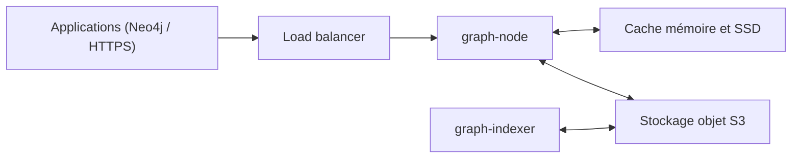

# hydra-db/hydradb

> Distributed graph database in Rust, on S3 object storage, queried with OpenCypher or Bolt.

## The problem
Classic graph databases tie compute to storage, which complicates scaling and node replacement.

## What it actually does
Durable storage (SlateDB) lives in S3-compatible object storage; query nodes and indexers keep only a disposable cache. OpenCypher queries on a consistent snapshot, GraphBLAS traversals, connection through Neo4j drivers (Bolt 5.x) and an HTTPS JSON or NDJSON API. Only one active writer per cell, designated by lease.

## How it is wired


## Trying it
```bash
git clone https://github.com/hydra-db/hydradb.git
cd hydradb
just native-check
just smoke
cargo run --locked --features server-runtime --bin graph-node
```

## Cost and gotchas
No GPU required (ignore the GPU line of the sheet: actual prerequisites: Rust 1.91, C/C++ toolchain, `libcypher-parser`, SuiteSparse GraphBLAS). `RUST_MIN_STACK=33554432` is needed, otherwise the node crashes on the first query. Created in July 2026, AGPL-3.0 license.

## What it is not
Not a full replacement for Neo4j: only a subset of OpenCypher is supported. Young repository, formal test targets are missing.

## Alternatives
Neo4j is cited as compatible through its drivers; no other alternative named.

## For you
Worth watching: the idea of a graph on object storage is interesting for knowledge graphs, but the project is very recent and under AGPL.
