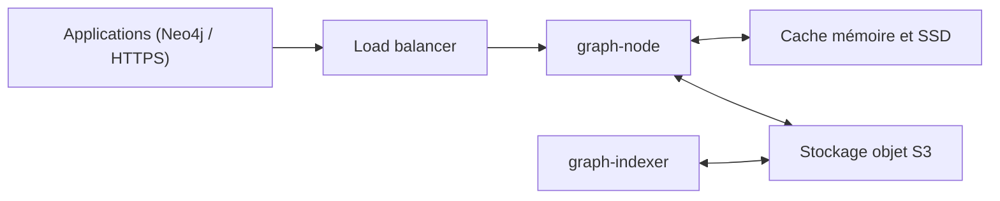

# hydra-db/hydradb

> Base de données graphe distribuée en Rust, sur stockage objet S3, requêtée en OpenCypher ou Bolt.

## Le problème
Les bases graphes classiques lient calcul et stockage, ce qui complique la mise à l'échelle et le remplacement des nœuds.

## Ce que ça fait vraiment
Le stockage durable (SlateDB) vit dans un stockage objet compatible S3 ; les nœuds de requête et les indexeurs gardent seulement un cache jetable. Requêtes OpenCypher sur un instantané cohérent, traversées GraphBLAS, connexion par pilotes Neo4j (Bolt 5.x) et API HTTPS JSON ou NDJSON. Un seul écrivain actif par cellule, désigné par bail.

## Comment c'est branché


## Essayer
```bash
git clone https://github.com/hydra-db/hydradb.git
cd hydradb
just native-check
just smoke
cargo run --locked --features server-runtime --bin graph-node
```

## Coût et pièges
Pas de GPU requis (la ligne GPU de la fiche est à ignorer : prérequis réels : Rust 1.91, chaîne C/C++, `libcypher-parser`, SuiteSparse GraphBLAS). `RUST_MIN_STACK=33554432` est nécessaire, sinon le nœud plante à la première requête. Créé en juillet 2026, licence AGPL-3.0.

## Ce que ce n'est pas
Pas un remplaçant complet de Neo4j : seul un sous-ensemble d'OpenCypher est pris en charge. Dépôt jeune, des cibles de test formel y sont absentes.

## Alternatives
Neo4j est cité comme compatible via ses pilotes ; aucune autre alternative nommée.

## Pour toi
À surveiller : l'idée d'un graphe sur stockage objet intéresse pour des graphes de connaissances, mais le projet est très récent et sous AGPL.

