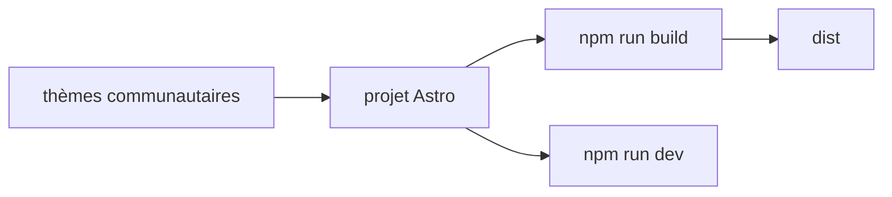

# hydralauncher/hydra-themes

> Repository of community themes for Hydra Launcher and its Astro showcase site.

## The problem
Themes created by the Hydra Launcher community need a common place to be shared.

## What it actually does
Stores the themes proposed by the community. The themes website is an Astro project run with `npm` commands. The README is very short and points to the documentation for creating and submitting a theme.

## How it is wired
Simplified diagram based on the sheet, no diagram provided.



## Trying it
```bash
npm install
npm run dev
npm run build
npm run preview
```

## Cost and gotchas
Free; Node and npm are enough. The README is too short to judge the internal structure.

## What it is not
Not the launcher itself: only its themes and the site that showcases them.

## Alternatives
No alternative named in the README.

## For you
Ignore: themes for a game launcher, unrelated to data, AI or MLOps work.
