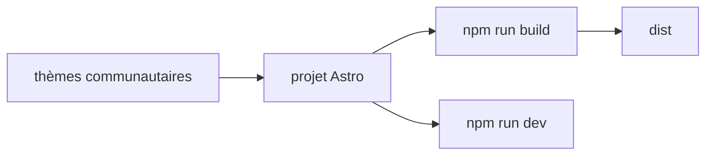

# hydralauncher/hydra-themes

> Dépôt de thèmes communautaires pour Hydra Launcher et son site de présentation en Astro.

## Le problème
Les thèmes créés par la communauté d'Hydra Launcher ont besoin d'un lieu commun pour être partagés.

## Ce que ça fait vraiment
Stocke les thèmes proposés par la communauté. Le site web des thèmes est un projet Astro lancé avec les commandes `npm`. Le README est très court et renvoie à la documentation pour créer et soumettre un thème.

## Comment c'est branché
Schéma simplifié d'après la fiche, sans diagramme fourni.



## Essayer
```bash
npm install
npm run dev
npm run build
npm run preview
```

## Coût et pièges
Gratuit ; Node et npm suffisent. Le README est trop court pour juger la structure interne.

## Ce que ce n'est pas
Pas le lanceur lui-même : seulement ses thèmes et le site qui les présente.

## Alternatives
Aucune alternative nommée dans le README.

## Pour toi
À ignorer : thèmes pour un lanceur de jeux, sans lien avec un travail data, IA ou MLOps.

