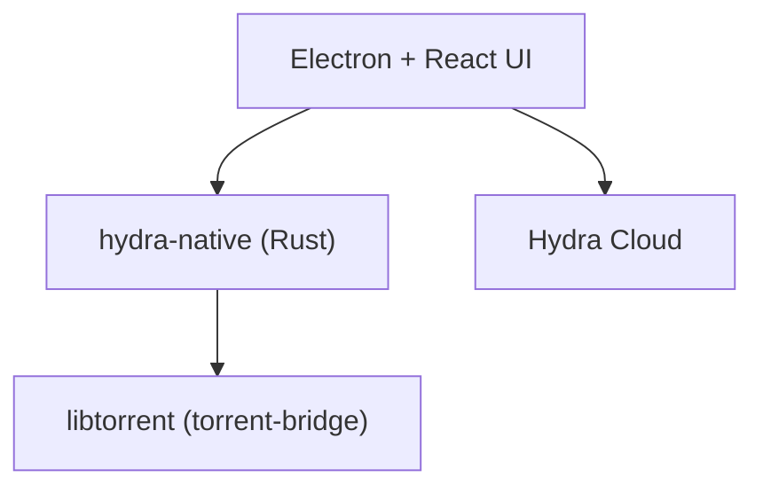

# hydralauncher/hydra

> Open source game launcher (Electron, React, Rust) to manage your library, with the libtorrent torrent engine.

## The problem
Managing your game library, your profile and your saves in a single tool.

## What it actually does
Desktop application in Node.js (Electron, React, TypeScript) and Rust. Listed features: game library, profile visible to friends, cloud saves via Hydra Cloud, achievements, catalog with suggestions. A native `hydra-native` addon in Rust wraps libtorrent.

## How it is wired


## Trying it
```bash
# Le README fourni ne donne que des prérequis de développement (pas de commande) :
# Node.js + Yarn, toolchain Rust, Git et toolchain C++.
# postinstall construit l'addon natif ; HYDRA_TORRENT_BRIDGE_FROM_SOURCE=1 force la compilation de libtorrent.
```

## Cost and gotchas
Free. Heavy build chain (Rust, C++, vcpkg) outside Windows x64 and Linux x64. Hydra Cloud is a third-party service.

## What it is not
Not a data or AI tool. The README does not document a binary installation for the end user.

## Alternatives
No alternative named in the README.

## For you
Ignore: consumer gaming application, unrelated to a data, AI or MLOps profile.
