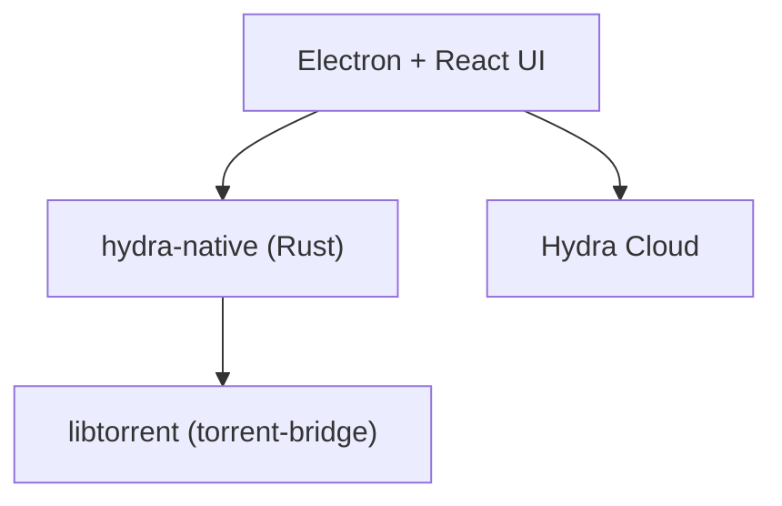

# hydralauncher/hydra

> Lanceur de jeux open source (Electron, React, Rust) pour gérer sa bibliothèque, avec moteur torrent libtorrent.

## Le problème
Gérer sa bibliothèque de jeux, son profil et ses sauvegardes dans un seul outil.

## Ce que ça fait vraiment
Application de bureau en Node.js (Electron, React, TypeScript) et Rust. Fonctions listées : bibliothèque de jeux, profil visible par les amis, sauvegardes cloud via Hydra Cloud, succès, catalogue avec suggestions. Un addon natif `hydra-native` en Rust enveloppe libtorrent.

## Comment c'est branché


## Essayer
```bash
# Le README fourni ne donne que des prérequis de développement (pas de commande) :
# Node.js + Yarn, toolchain Rust, Git et toolchain C++.
# postinstall construit l'addon natif ; HYDRA_TORRENT_BRIDGE_FROM_SOURCE=1 force la compilation de libtorrent.
```

## Coût et pièges
Gratuit. Chaîne de compilation lourde (Rust, C++, vcpkg) hors Windows x64 et Linux x64. Hydra Cloud est un service tiers.

## Ce que ce n'est pas
Pas un outil de data ou d'IA. Le README ne documente pas d'installation binaire pour l'utilisateur final.

## Alternatives
Aucune alternative nommée dans le README.

## Pour toi
Ignorer : application grand public de jeux, sans rapport avec un profil data, IA ou MLOps.

