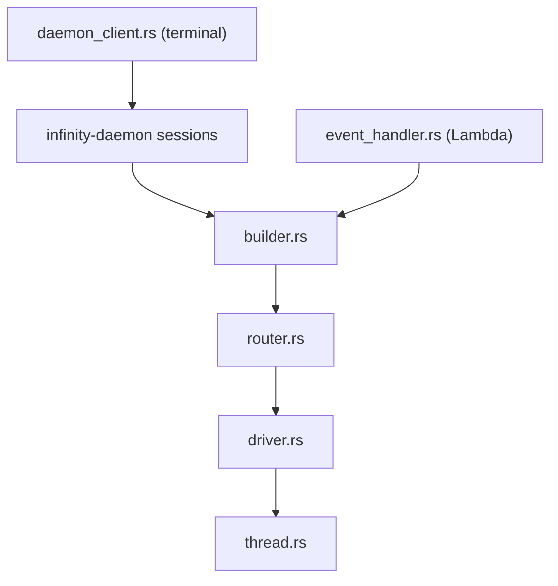

# hydro-project/infinity

> Rust framework for lightweight concurrent agents that hibernate for free between conversation turns.

## The problem
Agents block on slow tools and cost memory even while they wait.

## What it actually does
An agent is just data between two turns: a history with no task or connection. The same code runs as a resident process or on AWS Lambda (CDK provided). The project adds the RAP protocol to serve tools without an open connection, with an MCP gateway, and a code agent with sandboxes.

## How it is wired


## Trying it
```bash
# Pas de commande shell dans le README ; extrait Rust :
# AgentSystemBuilder::new_local(InMemoryConversationStore::new(), InMemoryStateStore::new(), StaticModel::new(provider, "global.anthropic.claude-sonnet-4-6").await?).start();
```

## Cost and gotchas
A model provider (the example targets Claude via a cloud provider) is at your expense. Lambda requires an AWS account. Chains not verified in the code depending on the architecture.

## What it is not
Not a Python framework or a turnkey platform: a young Rust library, several links between subsystems are only documented.

## Alternatives
No alternative named in the README.

## For you
Interesting idea for large-scale serverless agents; too young and in Rust, so keep an eye on it.
