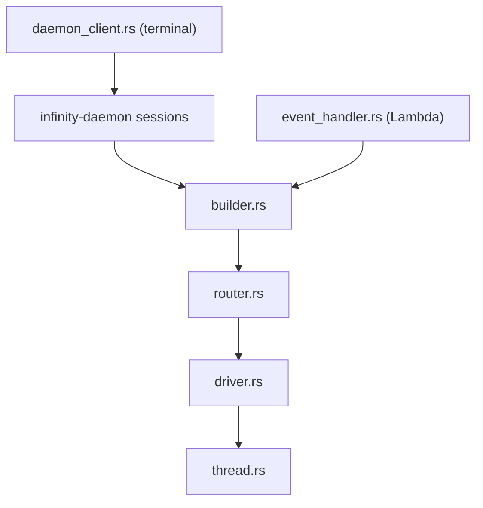

# hydro-project/infinity

> Framework Rust pour agents concurrents légers, qui hibernent gratuitement entre deux tours de conversation.

## Le problème
Les agents bloquent sur des outils lents et coûtent de la mémoire même quand ils attendent.

## Ce que ça fait vraiment
Un agent n'est que de la donnée entre deux tours : historique sans tâche ni connexion. Le même code tourne en processus résident ou sur AWS Lambda (CDK fournis). Le projet ajoute le protocole RAP pour servir des outils sans connexion ouverte, avec passerelle MCP, et un agent de code à sandboxes.

## Comment c'est branché


## Essayer
```bash
# Pas de commande shell dans le README ; extrait Rust :
# AgentSystemBuilder::new_local(InMemoryConversationStore::new(), InMemoryStateStore::new(), StaticModel::new(provider, "global.anthropic.claude-sonnet-4-6").await?).start();
```

## Coût et pièges
Un fournisseur de modèle (l'exemple cible Claude via un fournisseur cloud) est à ta charge. Lambda suppose un compte AWS. Chaînes non vérifiées dans le code selon l'architecture.

## Ce que ce n'est pas
Pas un framework Python ni une plateforme clé en main : bibliothèque Rust jeune, plusieurs liens entre sous-systèmes ne sont que documentés.

## Alternatives
Aucune alternative nommée dans le README.

## Pour toi
Idée intéressante pour des agents serverless à grande échelle ; trop jeune et en Rust, donc à surveiller.

