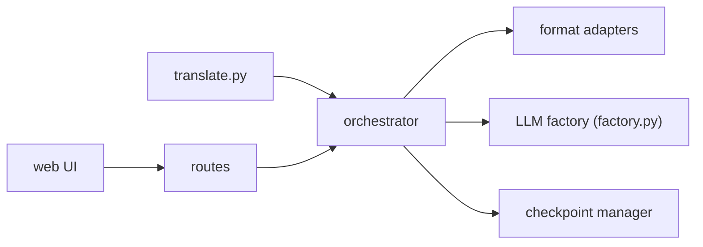

# hydropix/TranslateBooksWithLLMs

> Desktop application that translates books, subtitles and documents with a local or cloud LLM.

## The problem
Translating an entire novel with an LLM exceeds the context window and breaks formatting (EPUB, SRT).

## What it actually does
Splits into chunks (450 tokens by default), translates with a provider of your choice (Ollama, OpenAI, Gemini, Mistral, DeepSeek, OpenRouter, Poe, NIM), reassembles while preserving tags and timing. Checkpoint resume, automatic glossary and style, refinement pass, optional text-to-speech. EPUB, SRT, DOCX, TXT formats; web interface on port 5000.

## How it is wired


## Trying it
```bash
ollama pull qwen3:14b
python translate.py -i book.epub -sl English -tl French
docker build -t translatebook .
```

## Cost and gotchas
Free locally with Ollama (GPU or lots of RAM depending on the model); otherwise cloud keys at your expense (rotation of several free keys is supported). Server without accounts: all browsers share the state. AGPL-3.0.

## What it is not
Not a quality guarantee: it depends on the model and the language (a benchmark is provided). The README claims "perfect" preservation of formatting, not verified here.

## Alternatives
No alternative named in the README.

## For you
Worth watching: a concrete case of LLM orchestration (chunking, resume, glossary) that is reusable; a local model is enough to try it at no cost.
