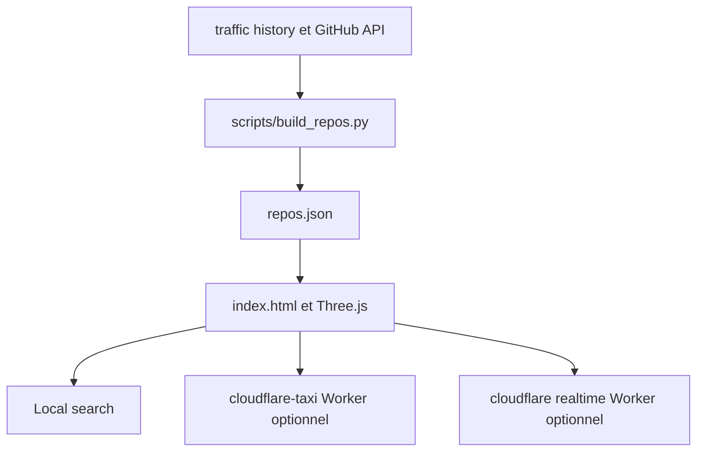

# hyeonsangjeon/Repolis

> Static web application that turns the public repositories of a GitHub account into an explorable 3D city.

## The problem
A portfolio of repositories boils down to a list of stars; few people really explore it.

## What it actually does
Enter a GitHub login or `owner/repo`: the public metadata becomes a Three.js city (visitors as height, forks as width, clones as banners). A guide, Gitber, searches in natural language. Traffic requires a `GH_PAT` token; without it, stars, forks and recency are enough. The application is static, with no build step.

## How it is wired


## Trying it
```bash
git clone https://github.com/hyeonsangjeon/Repolis
cd Repolis
python3 -m http.server 8000 --protocol HTTP/1.1
GTM_DIR=data python3 scripts/build_repos.py
```
The second data command first requires `gh auth login`.

## Cost and gotchas
Free as static; Three.js comes from a CDN. The Cloudflare services and the `GH_PAT` token are optional. The demo's more advanced questions go through external services.

## What it is not
Not a code analysis tool: the "Blueprint" view shows a file tree, not a call graph. Not a traffic dashboard without a token.

## Alternatives
No alternative named in the README.

## For you
Worth watching: a useful curiosity for presenting a portfolio or seeing a playful data visualization, with no MLOps stakes.
