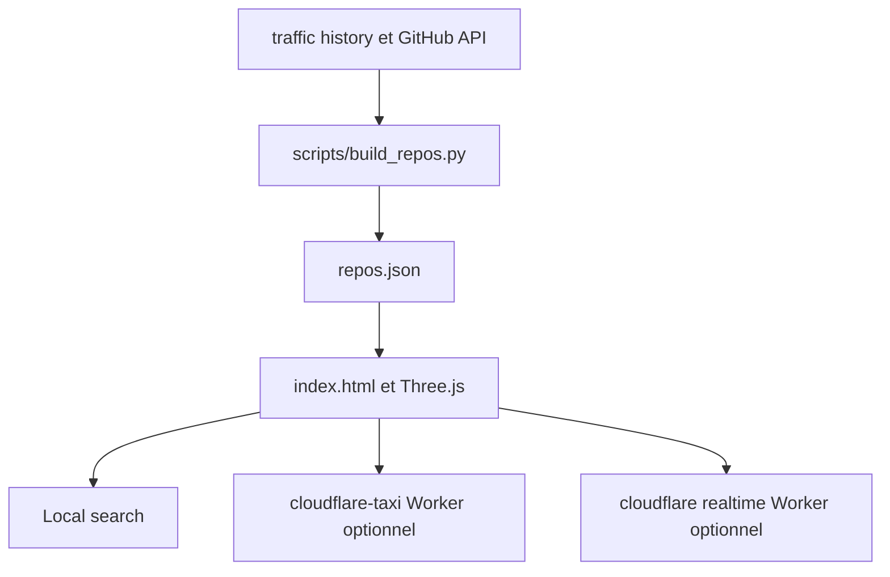

# hyeonsangjeon/Repolis

> Application web statique qui transforme les dépôts publics d'un compte GitHub en ville 3D explorable.

## Le problème
Un portefeuille de dépôts se résume à une liste de stars ; peu de gens l'explorent vraiment.

## Ce que ça fait vraiment
Saisis un login GitHub ou `owner/repo` : les métadonnées publiques deviennent une ville Three.js (visiteurs en hauteur, forks en largeur, clones en bannières). Un guide, Gitber, cherche en langage naturel. Le trafic exige un jeton `GH_PAT` ; sans lui, étoiles, forks et récence suffisent. L'application est statique, sans compilation.

## Comment c'est branché


## Essayer
```bash
git clone https://github.com/hyeonsangjeon/Repolis
cd Repolis
python3 -m http.server 8000 --protocol HTTP/1.1
GTM_DIR=data python3 scripts/build_repos.py
```
La seconde commande de données demande d'abord `gh auth login`.

## Coût et pièges
Gratuit en statique ; Three.js vient d'un CDN. Les services Cloudflare et le jeton `GH_PAT` sont optionnels. Les questions poussées de la démo passent par des services externes.

## Ce que ce n'est pas
Pas un outil d'analyse de code : la vue « Blueprint » montre une arborescence, pas un graphe d'appels. Pas un tableau de bord de trafic sans jeton.

## Alternatives
Aucune alternative nommée dans le README.

## Pour toi
À surveiller : curiosité utile pour présenter un portfolio ou voir une visualisation de données ludique, sans enjeu MLOps.

