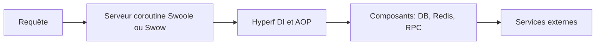

# hyperf/hyperf

> Command-line PHP framework, based on Swoole or Swow coroutines, for microservices.

## The problem
PHP-FPM frameworks handle very high loads and microservices poorly; coroutine-friendly clients are lacking.

## What it actually does
A coroutine server with dependency injection and aspect-oriented programming, plus components: MySQL and Redis clients, WebSocket, JSON-RPC, gRPC, AMQP, Consul, ETCD, rate limiter, circuit breaker, Eloquent ORM. The components follow PSR standards and are reusable elsewhere. The README reports a test at about 104,000 requests per second on 8 cores.

## How it is wired
Simplified diagram based on the sheet, no diagram provided.

## Trying it
No command in the README; it points to the hyperf.io site and the hyperf.wiki documentation.

## Cost and gotchas
Free, MIT. Requires PHP 8.1 and Swoole 5.0 or Swow 1.4. Part of the documentation is in Chinese. The performance figure is a measurement by the team, not compared in the README.

## What it is not
Not a classic PHP-FPM framework: the code runs in a persistent process, with its coroutine constraints.

## Alternatives
No alternative named in the README (PHP-FPM is cited as a performance benchmark).

## For you
Ignore for a data / AI profile: PHP and Swoole coroutines are far from your tooling, unless you have a high-traffic PHP web project.
