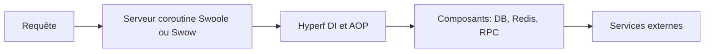

# hyperf/hyperf

> Framework PHP en ligne de commande, fondé sur les coroutines Swoole ou Swow, pour microservices.

## Le problème
Les frameworks PHP-FPM traitent mal les très fortes charges et les microservices ; il manque des clients adaptés aux coroutines.

## Ce que ça fait vraiment
Un serveur coroutine avec injection de dépendances et programmation orientée aspects, plus des composants : clients MySQL et Redis, WebSocket, JSON-RPC, gRPC, AMQP, Consul, ETCD, limiteur de débit, disjoncteur, ORM Eloquent. Les composants suivent les normes PSR et sont réutilisables ailleurs. Le README donne un test à environ 104 000 requêtes par seconde sur 8 cœurs.

## Comment c'est branché
Schéma simplifié d'après la fiche, sans diagramme fourni.

## Essayer
Aucune commande dans le README ; il renvoie au site hyperf.io et à la documentation hyperf.wiki.

## Coût et pièges
Gratuit, MIT. Exige PHP 8.1 et Swoole 5.0 ou Swow 1.4. Une partie de la documentation est en chinois. Le chiffre de performance est une mesure de l'équipe, non comparée dans le README.

## Ce que ce n'est pas
Ce n'est pas un framework PHP-FPM classique : le code tourne dans un processus persistant, avec ses contraintes de coroutines.

## Alternatives
Aucune alternative nommée dans le README (PHP-FPM est cité comme repère de performance).

## Pour toi
À ignorer pour un profil data / IA : PHP et coroutines Swoole sont loin de ton outillage, sauf projet web PHP à fort trafic.

