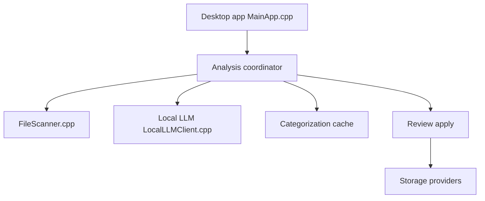

# hyperfield/ai-file-sorter

> A desktop application that sorts and renames your files with a local or remote model.

## The problem
Download folders or network storage overflow with files with generic names like `IMG_2048.jpg`.

## What it actually does
It scans a folder, proposes categories and subcategories, then clearer names based on the content of images and documents or on audio and video metadata. Nothing is moved before you confirm; an "Undo last run" exists. It runs with a local model (Gemma 3 4B by default) or an OpenAI, Gemini or compatible API.

## How it is wired
Diagram taken from the code, simplified.



## Trying it
```bash
sudo apt install ./aifilesorter_*.deb
```

## Cost and gotchas
Free with a local model. A remote model requires your own API key and its quota. Building from source requires Qt 6 and a C++20 compiler.

## What it is not
Not a pipeline tool: it is a graphical application for personal folders. AGPL-3.0 license, to be reviewed before reusing it.

## Alternatives
No alternative named in the README.

## For you
Ignore: useful for tidying your personal folders, but of no interest for a data or MLOps profile, and the AGPL hinders any reuse.
