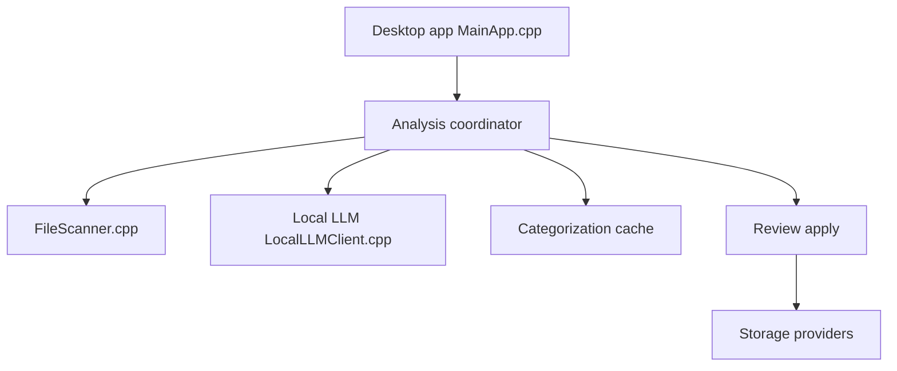

# hyperfield/ai-file-sorter

> Une application de bureau qui trie et renomme tes fichiers avec un modèle local ou distant.

## Le problème
Les dossiers de téléchargements ou de stockage réseau débordent de fichiers aux noms génériques comme `IMG_2048.jpg`.

## Ce que ça fait vraiment
Elle scanne un dossier, propose catégories et sous-catégories, puis des noms plus clairs d'après le contenu des images, des documents ou les métadonnées audio et vidéo. Rien n'est déplacé avant ta validation ; un « Undo last run » existe. Elle tourne avec un modèle local (Gemma 3 4B par défaut) ou une API OpenAI, Gemini ou compatible.

## Comment c'est branché
Diagramme tiré du code, simplifié.



## Essayer
```bash
sudo apt install ./aifilesorter_*.deb
```

## Coût et pièges
Gratuit avec un modèle local. Un modèle distant demande ta propre clé d'API et son quota. La compilation depuis les sources demande Qt 6 et un compilateur C++20.

## Ce que ce n'est pas
Pas un outil de pipeline : c'est une application graphique pour dossiers personnels. Licence AGPL-3.0, à examiner avant de la réutiliser.

## Alternatives
Aucune alternative nommée dans le README.

## Pour toi
À ignorer : utile pour ranger tes dossiers personnels, mais sans intérêt pour un profil data ou MLOps, et l'AGPL gêne toute réutilisation.

