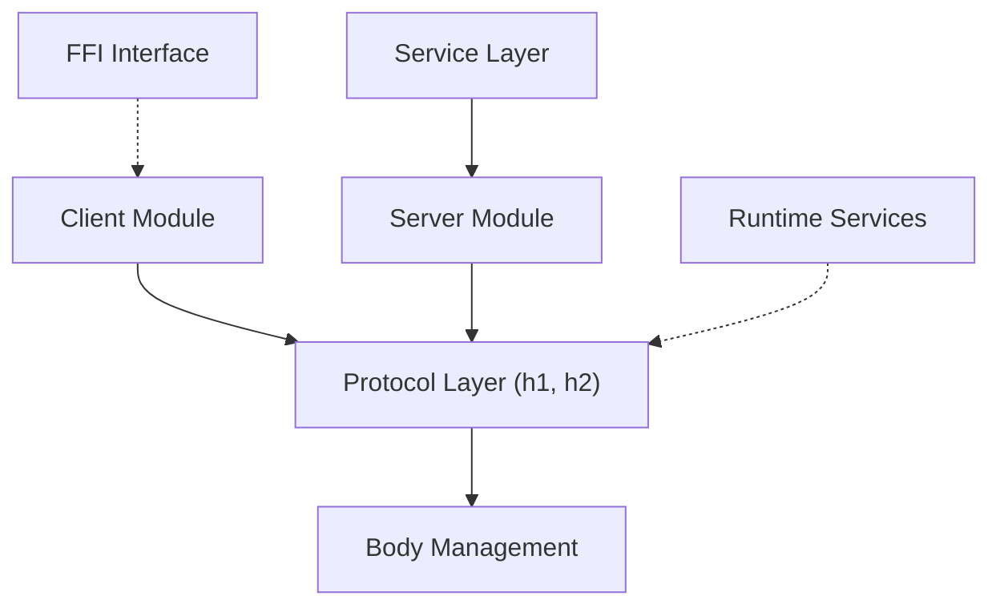

# hyperium/hyper

> Low-level asynchronous Rust HTTP library, serving as a building block for clients and servers.

## The problem
You need a correct and fast HTTP/1 and HTTP/2 foundation to build clients and servers in Rust.

## What it actually does
Provides HTTP/1 and HTTP/2, client and server APIs, an asynchronous design. Low-level: the README points to reqwest (client), axum or warp (server), all built on top of it. The code also contains a C FFI interface.

## How it is wired
Diagram based on the code's diagram, simplified.

## Trying it
No command in the README: see the guides.

## Cost and gotchas
Free (MIT). Rust required, missing from the prerequisites. An asynchronous runtime is needed according to the code.

## What it is not
Not a convenient HTTP client nor a web framework: low-level, according to the README.

## Alternatives
- reqwest: a more convenient HTTP client.
- axum: server built on hyper.
- warp: server with a functional approach.

## For you
Ignore: a low-level Rust building block; you will use it indirectly through reqwest or axum without choosing it.
