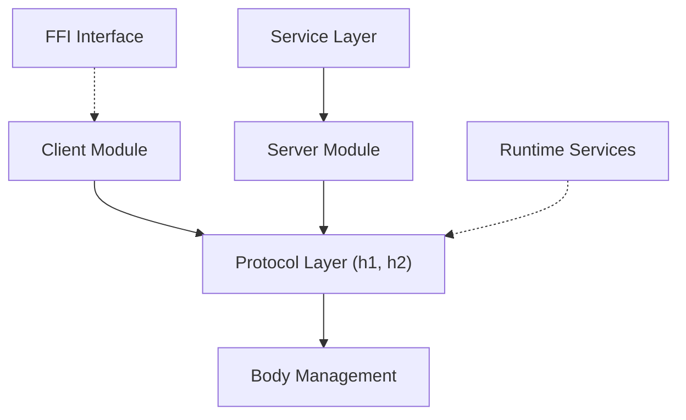

# hyperium/hyper

> Bibliothèque HTTP Rust de bas niveau, asynchrone, servant de brique à des clients et serveurs.

## Le problème
Il faut un socle HTTP/1 et HTTP/2 correct et rapide pour construire clients et serveurs en Rust.

## Ce que ça fait vraiment
Fournit HTTP/1 et HTTP/2, API client et serveur, conception asynchrone. Bas niveau : le README oriente vers reqwest (client), axum ou warp (serveur), tous construits dessus. Le code contient aussi une interface FFI C.

## Comment c'est branché
Schéma d'après le diagramme du code, simplifié.

## Essayer
Aucune commande dans le README : voir les guides.

## Coût et pièges
Gratuit (MIT). Rust requis, absent des prérequis. Un runtime asynchrone est nécessaire d'après le code.

## Ce que ce n'est pas
Pas un client HTTP pratique ni un framework web : bas niveau, d'après le README.

## Alternatives
- reqwest : client HTTP plus pratique.
- axum : serveur construit sur hyper.
- warp : serveur d'approche fonctionnelle.

## Pour toi
À ignorer : brique Rust de bas niveau ; tu l'utiliseras indirectement via reqwest ou axum sans la choisir.

