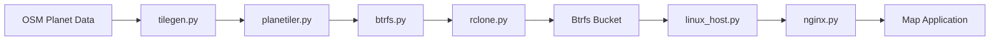

# hyperknot/openfreemap

> Free hosting of OpenStreetMap vector tiles, public instance or self-hosted.

## The problem
Displaying a map on a website means paying a tile provider or maintaining a delicate tile server.

## What it actually does
Public instance with no key, no limit, no cookies, funded by donations.
`tilegen`: OSM planet → Planetiler → MBTiles → compressed Btrfs image → R2 bucket via rclone, every week.
`linux_host`: downloads and mounts the Btrfs images, serves tiles with nginx, with no tile server.
Fabric deployment over SSH on Ubuntu 24.04; weekly planet downloads.

## How it is wired


## Trying it
```bash
./linux_host/scripts/linux_host.py --help
```

## Cost and gotchas
Free; self-hosting needs clean dedicated servers. OSM attribution is mandatory.

## What it is not
No geocoding, routing, raster tiles or satellite imagery. Cannot be installed locally and has no Docker, by choice.

## Alternatives
No alternative named (PMTiles is cited and dismissed for cloud cost reasons).

## For you
Worth watching: a free base map ideal for a demo or a geo dashboard, provided you check the license and accept the dependency on a single maintainer.
