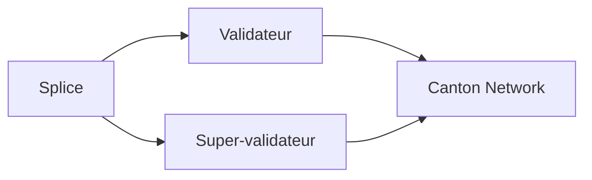

# hyperledger-labs/splice

> Applications for operating validators and super-validators on the Canton network.

## The problem
Not documented in the README: only the goal of operating Canton network nodes is mentioned.

## What it actually does
Applications for operating validators and super-validators of the Canton Network. The detail is not documented in the README provided, which points to the DEVELOPMENT, TESTING, TROUBLESHOOTING, CONTRIBUTING and AI_POLICY guides.

## How it is wired

## Trying it
No command documented in the README provided; see the guides it points to.

## Cost and gotchas
Not documented. 1,030 open issues for 120 stars; probably requires access to the Canton network.

## What it is not
Not a general-purpose or data/AI tool: it is tied to operating a blockchain network. README too short to say more.

## Alternatives
No alternative named in the README.

## For you
Ignore: specific to Canton infrastructure, unrelated to a data/AI/MLOps profile, and the README is insufficient to judge.
