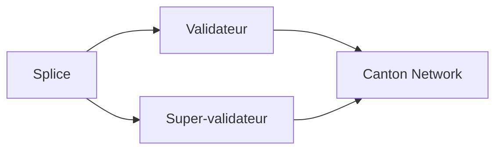

# hyperledger-labs/splice

> Applications pour exploiter des validateurs et super-validateurs sur le réseau Canton.

## Le problème
Non documenté dans le README : seul l'objectif d'exploiter des nœuds du réseau Canton est mentionné.

## Ce que ça fait vraiment
Applications pour opérer des validateurs et super-validateurs du Canton Network. Le détail n'est pas documenté dans le README fourni, qui renvoie aux guides DEVELOPMENT, TESTING, TROUBLESHOOTING, CONTRIBUTING et AI_POLICY.

## Comment c'est branché

## Essayer
Aucune commande documentée dans le README fourni ; voir les guides renvoyés.

## Coût et pièges
Non documenté. 1 030 issues ouvertes pour 120 étoiles ; nécessite sans doute l'accès au réseau Canton.

## Ce que ce n'est pas
Pas un outil généraliste ni data/IA : il est lié à l'exploitation d'un réseau blockchain. README trop court pour en dire plus.

## Alternatives
Aucune alternative nommée dans le README.

## Pour toi
Ignorer : spécifique à l'infrastructure Canton, sans rapport avec un profil data/IA/MLOps, et README insuffisant pour en juger.

