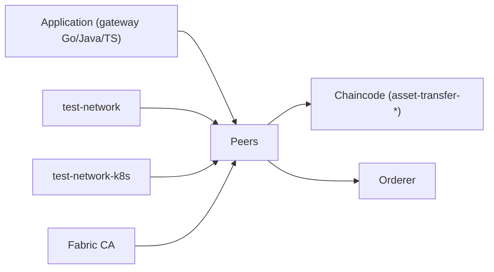

# hyperledger/fabric-samples

> Official samples for learning Hyperledger Fabric: test network, contracts and client applications.

## The problem
Getting started with a permissioned blockchain requires assembling a test network, contracts and SDKs.

## What it actually does
A Docker Compose test network (two organizations and an orderer) and a Kubernetes variant. Series of "asset transfer" samples (basic, queries, private data, endorsement, secured agreement, events, ABAC), ERC-20, ERC-721, ERC-1155 and UTXO tokens, auctions and a full-stack guide. Contracts in Go, JavaScript, TypeScript and Java.

## How it is wired

## Trying it
The README refers to the Fabric documentation for installing binaries and Docker images; it gives no shell command. The network is launched from `test-network` following its tutorial.

## Cost and gotchas
Free. Docker and the Fabric images are required. The samples follow the latest version; older ones have their own branches.

## What it is not
Not a database or a production solution. It is a teaching resource.

## Alternatives
No alternative named in the README.

## For you
Ignore: useful only if you need to evaluate Hyperledger Fabric, outside the data/AI/MLOps core.
