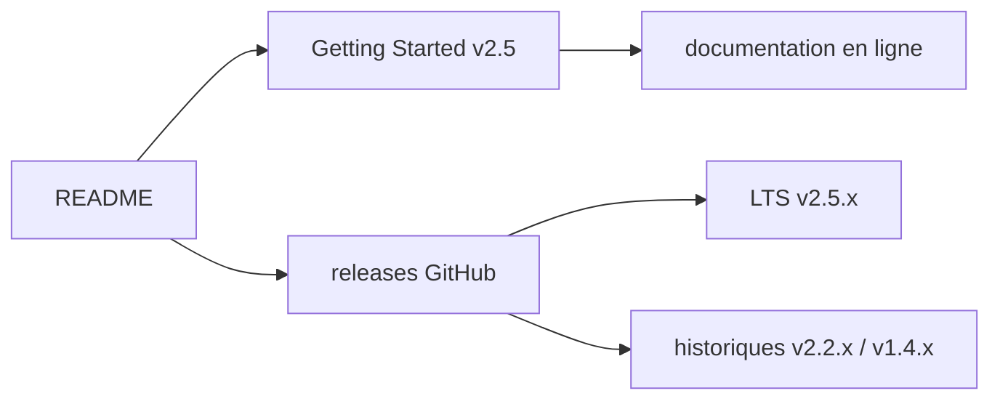

# hyperledger/fabric

> Modular, permissioned distributed ledger platform for enterprise consortia.

## The problem
Sharing a ledger between organizations that do not trust each other without exposing
all transactions to everyone.

## What it actually does
The README is short and only describes the framework: modular architecture with
replaceable implementations for each component, oriented toward confidentiality,
resilience, flexibility and scalability. "Graduated" project under the
Hyperledger umbrella. Release policy with long-term support: v2.5.x is the
current LTS, v2.2.x (end of February 2024) and v1.4.x (end of April 2021) are historical.
Everything else — components, transaction flow — is deferred to the online
documentation "Getting Started with v2.5".

## How it is wired

## Trying it
No command documented in this README: it defers entirely to the
"Getting Started" section of the online documentation.

## Cost and gotchas
Free. The cost is operational: a Fabric network requires several
organizations, certificate authorities, orderers and peers to
operate. The README says nothing about this.

## What it is not
It is not a public blockchain or a cryptocurrency: permissioned ledger,
known participants. The README alone does not allow judging the tool — insufficient
material, the external documentation must be read for any decision.

## Alternatives
- No alternative repository named in the README.

## For you
No connection with a data / AI / MLOps use. Ignore.
