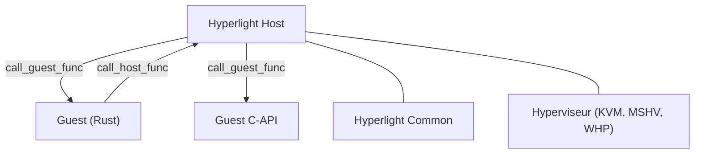

# hyperlight-dev/hyperlight

> Lightweight virtual machine in Rust to run untrusted code in hypervisor-isolated micro-VMs.

## The problem
Running third-party or generated code requires strong isolation, but a classic VM starts too slowly and costs too much memory.

## What it actually does
You embed it as a Rust library, give it a guest binary (`no_std` ELF in Rust or C) and call its functions across the VM boundary. There is no kernel or guest OS; the guest has no files or network by default. Snapshots restore state between calls. KVM, MSHV, WHP and HVF are supported depending on the platform.

## How it is wired


## Trying it
```bash
# Pas de commande shell dans le README : exemple Rust avec SandboxBuilder::from_file(guest_path),
# puis sandbox.call("SayHello", ...) ; voir docs/getting-started.md.
```

## Cost and gotchas
Free. An accessible hypervisor is required (KVM, MSHV, WHP or HVF) and guests must be written in Rust or C. The README announces a pre-1.0 status: the API may change between versions.

## What it is not
It is not general-purpose virtualization nor a way to launch a full Linux with system calls, network or files, which the README rules out.

## Alternatives
hyperlight-wasm, hyperlight-js, hyperlight-sandbox and hyperlight-unikraft, neighboring projects from the same ecosystem.

## For you
Worth watching: relevant to isolate code generated by AI agents, but still pre-1.0 and requiring Rust.
