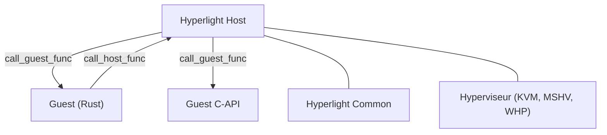

# hyperlight-dev/hyperlight

> Machine virtuelle légère en Rust pour exécuter du code non fiable dans des micro-VM isolées par hyperviseur.

## Le problème
Exécuter du code tiers ou généré demande une isolation forte, mais une VM classique démarre trop lentement et coûte trop de mémoire.

## Ce que ça fait vraiment
On l'intègre comme bibliothèque Rust, on lui donne un binaire invité (ELF `no_std` en Rust ou C) et on appelle ses fonctions à travers la frontière de la VM. Il n'y a ni noyau ni OS invité ; l'invité n'a ni fichiers ni réseau par défaut. Des snapshots restaurent l'état entre les appels. KVM, MSHV, WHP et HVF sont pris en charge selon les plateformes.

## Comment c'est branché


## Essayer
```bash
# Pas de commande shell dans le README : exemple Rust avec SandboxBuilder::from_file(guest_path),
# puis sandbox.call("SayHello", ...) ; voir docs/getting-started.md.
```

## Coût et pièges
Gratuit. Il faut un hyperviseur accessible (KVM, MSHV, WHP ou HVF) et écrire les invités en Rust ou C. Le README annonce un statut pré-1.0 : l'API peut changer d'une version à l'autre.

## Ce que ce n'est pas
Ce n'est pas une virtualisation généraliste ni un moyen de lancer un Linux complet avec appels système, réseau ou fichiers, ce que le README exclut.

## Alternatives
hyperlight-wasm, hyperlight-js, hyperlight-sandbox et hyperlight-unikraft, projets voisins du même écosystème.

## Pour toi
À surveiller : pertinent pour isoler du code généré par des agents IA, mais encore pré-1.0 et demandant du Rust.

