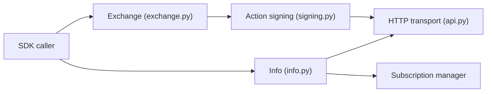

# hyperliquid-dex/hyperliquid-python-sdk

> Python SDK to read market data and place orders on the Hyperliquid platform.

## The problem
Talking to Hyperliquid's HTTP and WebSocket API requires signing actions yourself.

## What it actually does
- `Info`: user state, market data, WebSocket subscriptions.
- `Exchange`: builds, signs and sends orders, transfers, staking, vaults.
- Private key and address are read from `examples/config.json`; a dedicated API wallet is possible.

## How it is wired


## Trying it
```bash
pip install hyperliquid-python-sdk
cp examples/config.json.example examples/config.json
python examples/basic_order.py
```

## Cost and gotchas
The SDK is free but handles real private keys: use the testnet first. Last push in June 2026, 102 open issues.

## What it is not
Not a strategy or backtesting engine; no financial advice.

## Alternatives
No alternative named in the README.

## For you
Watch: relevant only if you automate trading on Hyperliquid; be careful with key management.
