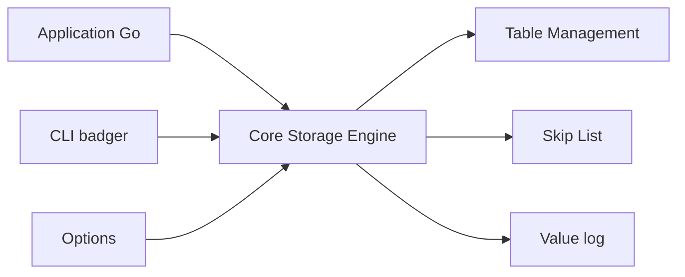

# hypermodeinc/badger

> Embeddable pure-Go key-value database, persistent, with ACID transactions, for Go applications.

## The problem
An embedded key-value store in Go with no C dependency (unlike RocksDB) and suited to SSDs.

## What it actually does
LSM storage library with a value log, inspired by the WiscKey paper. Concurrent ACID transactions with serializable snapshot isolation, TTL, snapshots, access to a key's versions. The README says it is stable and serves datasets of hundreds of terabytes (Dgraph, Jaeger, etc.). A CLI does offline backup and restore.

## How it is wired


## Trying it
```bash
go get github.com/dgraph-io/badger/v4
```
```bash
cd badger
go install .
```

## Cost and gotchas
Go 1.23+. On AIX, Windows, Plan9 and WASM, directory locking and `fsync` differ, with a durability risk (AIX). Check the module path (`dgraph-io/badger/v4`) against the repository name.

## What it is not
Not a distributed database or a server: it is an embedded library to integrate.

## Alternatives
RocksDB (LSM, but not pure Go), BoltDB (B+ tree, slow writes), LMDB (benchmarks cited).

## For you
Adopt it if you need local transactional key-value storage in a Go service; of little use outside the Go ecosystem.
