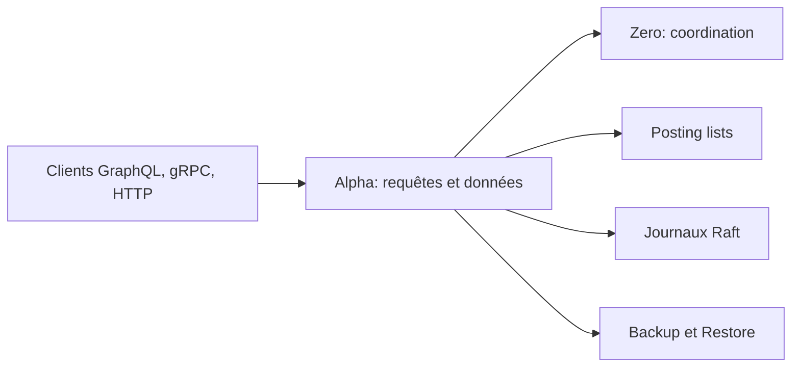

# hypermodeinc/dgraph

> Distributed graph database with GraphQL-like queries, for applications with highly connected data.

## The problem
More than ten SQL tables linked by foreign keys, or sparse data, are poorly modeled and queried in a relational database.

## What it actually does
Distributed, partitioned database, with ACID transactions, consistent replication and linearizable reads. Queries in a GraphQL-inspired language, JSON or Protocol Buffers responses over gRPC and HTTP, full-text search, regular expressions, geo. Written in Go. Zero nodes (coordination) and Alpha nodes (data, queries).

## How it is wired


## Trying it
```bash
docker pull dgraph/dgraph:latest
docker run -it -p 8080:8080 -p 9080:9080 -v ~/dgraph:/dgraph dgraph/standalone:latest
```

## Cost and gotchas
Free; building from source requires Go 1.27 or later. The license is declared Apache 2.0 by the README table but not declared in the catalog: the catalog prevails, to be verified.

## What it is not
Not a vector store nor an analytical database. The comparison with Neo4j and JanusGraph comes from the README, hence from the vendor.

## Alternatives
- Neo4j: single-server, Cypher queries, GPL v3 license according to the README.
- JanusGraph: layer on top of other distributed databases, Gremlin language.

## For you
Ignore unless you have a specific need for a distributed graph: a data/AI profile rarely meets this case, and the license remains to be confirmed.
