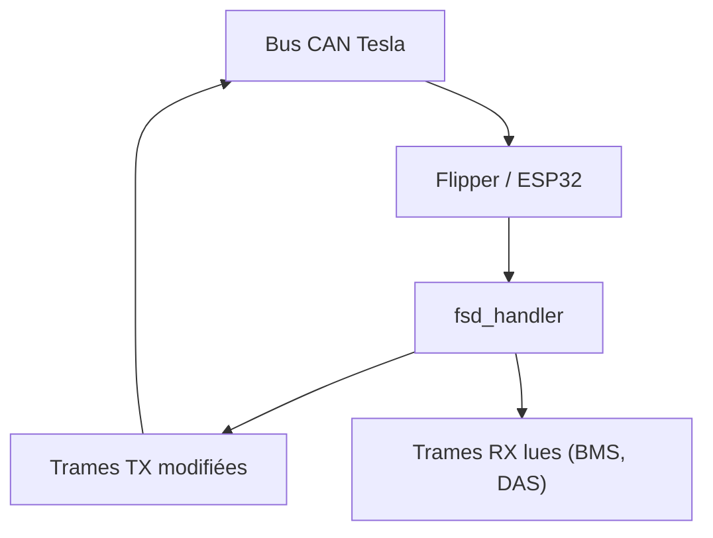

# hypery11/flipper-tesla-fsd

> Boîte à outils CAN pour Flipper Zero et ESP32 qui modifie des fonctions d'aide à la conduite Tesla.

## Le problème
Les fonctions FSD et d'aide à la conduite sont verrouillées par région ou par bannissement, et certains veulent les contourner.

## Ce que ça fait vraiment
Un firmware qui lit puis retransmet des trames CAN modifiées sur le bus Party : déblocage FSD par bits, suppresseur d'alerte mains au volant, rétablissement TLSSC sur voitures bannies, rejeu de la configuration du gateway, tableau de bord de batterie. Il reconnaît HW3, HW4 et les modèles plus anciens.

## Comment c'est branché


## Essayer
```bash
git clone https://github.com/hypery11/flipper-tesla-fsd.git
cd flipper-tesla-fsd
ufbt
cd esp32
pio run -e m5stack-atom
```

## Coût et pièges
Matériel : de 14 $ (ESP32) à plus de 200 $ avec un Flipper et le module CAN. Tesla bannit certains VIN depuis avril 2026. Le README partiel n'a pas été lu en entier (tronqué).

## Ce que ce n'est pas
Ne débloque pas un droit FSD : il faut déjà le forfait. Le rejeu de configuration n'empêche pas les bannissements. Modifier le bus d'un véhicule est risqué pour la sécurité routière et la garantie.

## Alternatives
S3XY Commander, outil commercial à plus de 200 $ cité comme référence de prix.

## Pour toi
Ignorer : piratage de véhicule sans rapport avec ton métier, juridiquement et physiquement risqué, sous licence non identifiée.

