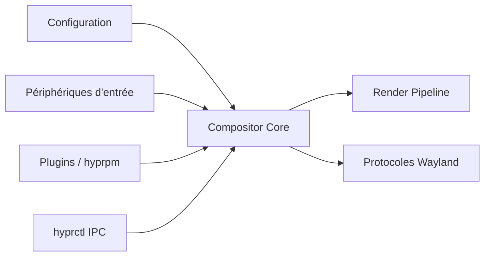

# hyprwm/Hyprland

> Dynamic tiling Wayland compositor, independent of wlroots, with animations and plugins.

## The problem
Wayland window managers are either austere or rigid when it comes to customization.

## What it actually does
A core (`Compositor.cpp`) ties together configuration with instant reload, an OpenGL rendering pipeline, Wayland protocols, input devices, managers and plugins. Layouts: Dwindle, Scrolling, Master, Monocle, and a custom layout in Lua. Tools: `hyprctl` (IPC socket) and `hyprpm` (plugin manager).

## How it is wired

## Trying it
The README points to the Install, Quick Start and Configure pages of the wiki; no command appears there.

## Cost and gotchas
Free. A Wayland environment and a compatible GPU are required; the project says it ships cutting-edge features, hence frequent changes.

## What it is not
Not a complete desktop environment: bar, launcher and other components must be added.

## Alternatives
No alternative named in the README.

## For you
Ignore: Linux workstation comfort, unrelated to data/AI work.
