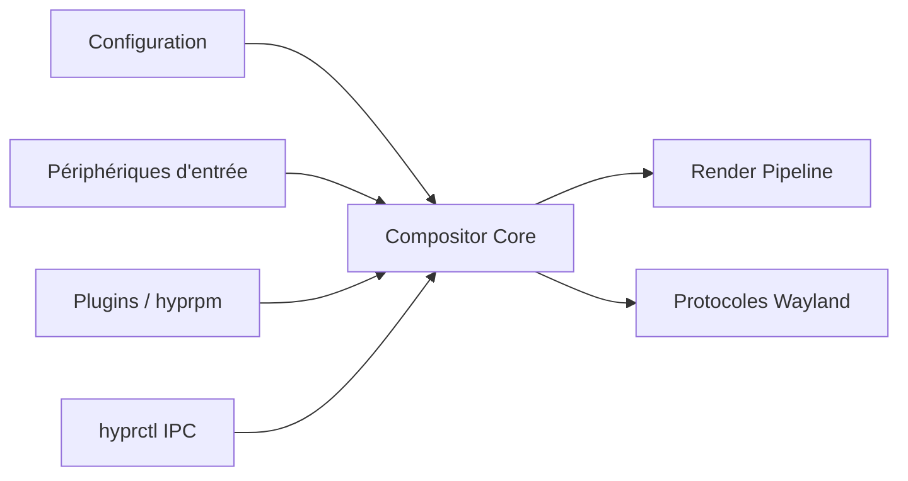

# hyprwm/Hyprland

> Compositeur Wayland en pavage dynamique, indépendant de wlroots, avec animations et plugins.

## Le problème
Les gestionnaires de fenêtres Wayland sont soit austères, soit rigides pour la personnalisation.

## Ce que ça fait vraiment
Un cœur (`Compositor.cpp`) relie configuration à rechargement instantané, pipeline de rendu OpenGL, protocoles Wayland, périphériques d'entrée, gestionnaires, plugins. Dispositions Dwindle, Scrolling, Master, Monocle, layout personnalisé en Lua. Outils : `hyprctl` (socket IPC) et `hyprpm` (gestionnaire de plugins).

## Comment c'est branché

## Essayer
Le README renvoie aux pages Install, Quick Start et Configure du wiki ; aucune commande n'y figure.

## Coût et pièges
Gratuit. Environnement Wayland et GPU compatible requis ; le projet annonce fournir des fonctions de pointe, donc des changements fréquents.

## Ce que ce n'est pas
Pas un environnement de bureau complet : barre, lanceur et autres éléments sont à ajouter.

## Alternatives
Aucune alternative nommée dans le README.

## Pour toi
Ignorer : confort de poste Linux, sans lien avec le travail data/IA.

