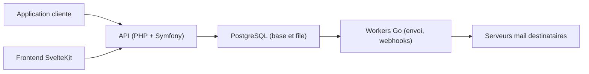

# hyvor/relay

> Self-hosted email sending API that goes through SMTP on your own infrastructure, for developers.

## The problem
Sending transactional and bulk emails without depending on a third-party service requires handling IP reputation, bounces and DNS.

## What it actually does
Hyvor Relay exposes a sending API and handles queues, greylisting, retries, bounces, feedback loops and suppression lists. It provides a built-in DNS server, 30-day SMTP conversation logs, webhooks, multi-tenancy and isolated projects. Observability through Prometheus and Grafana.

## How it is wired
Simplified diagram based on the sheet, no diagram provided.

## Trying it
The README gives no command: it points to the self-hosting documentation (Docker Compose or Swarm).

## Cost and gotchas
Free, but you need at least one server with dedicated IP addresses and command of DNS and deliverability. 54 open issues according to the catalog. The AGPL-3.0 should be weighed in case of redistribution.

## What it is not
It is not a managed service: you carry the deliverability and the reputation of your IPs. Nor is it a full marketing emailing tool.

## Alternatives
No alternative named in the README.

## For you
Worth watching: relevant only if you must host your own email sending; outside the data/AI core, and a real operating burden.
