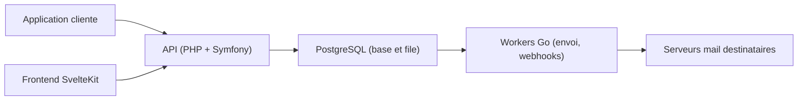

# hyvor/relay

> API d'envoi d'emails auto-hébergée qui passe par SMTP sur ta propre infrastructure, pour développeurs.

## Le problème
Envoyer des emails transactionnels et en masse sans dépendre d'un service tiers exige de gérer réputation d'IP, rebonds et DNS.

## Ce que ça fait vraiment
Hyvor Relay expose une API d'envoi et gère files d'attente, greylisting, nouvelles tentatives, rebonds, boucles de retour et listes de suppression. Il fournit un serveur DNS intégré, des journaux de conversations SMTP sur 30 jours, des webhooks, le multi-locataire et des projets isolés. Observabilité via Prometheus et Grafana.

## Comment c'est branché
Schéma simplifié d'après la fiche, sans diagramme fourni.

## Essayer
Le README ne donne pas de commande : il renvoie à la documentation d'auto-hébergement (Docker Compose ou Swarm).

## Coût et pièges
Gratuit, mais il faut au moins un serveur avec des adresses IP dédiées et la maîtrise du DNS et de la délivrabilité. 54 issues ouvertes d'après le catalogue. L'AGPL-3.0 est à peser en cas de redistribution.

## Ce que ce n'est pas
Ce n'est pas un service géré : tu portes la délivrabilité et la réputation de tes IP. Ce n'est pas non plus un outil d'e-mailing marketing complet.

## Alternatives
Aucune alternative nommée dans le README.

## Pour toi
À surveiller : pertinent seulement si tu dois héberger ton propre envoi d'emails ; hors cœur data/IA, et charge d'exploitation réelle.

